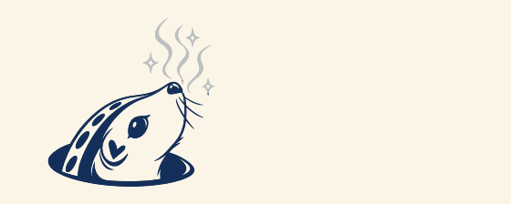
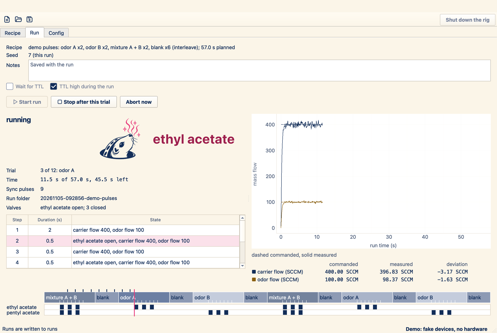

# Sniffler

Build, run, and record odor presentation experiments in one window.
Controls a LabJack U3 with a PS12DC valve board and Alicat mass flow controllers.

Scared of squirrels? Try [shuffler](https://github.com/gumadeiras/shuffler).



## Setup

1. Install [uv](https://docs.astral.sh/uv/getting-started/installation/).
2. [Download sniffler](https://github.com/gumadeiras/sniffler/archive/refs/heads/main.zip)
   and extract it. Open a terminal or PowerShell in the extracted folder and run:

   ```text
   uv sync
   uv run sniffler-gui --demo
   ```

The demo includes a sample recipe and fake devices. No hardware or device drivers
are needed. Press **Start run** to see the timeline, flow plot, and squirrel.

## Use your rig

[Install the device drivers and configure `lab.toml`](docs/setup.md), then open:

```text
uv run sniffler-gui
```

- Build trials and valve pulses in the **Recipe** tab. Save the recipe for reuse.
- Press **Start run** and watch the **Run** tab. Each run saves its recipe and data.
- **Stop after this trial** finishes the current trial and applies the recipe end state.
- **Abort now** stops at once, closes all valves, and sets every flow to zero.

Check the wiring, gas path, units, and flow limits before you use real devices.

[Recipes, controls, and troubleshooting](docs/guide.md) ·
[Commands, recording, and development](docs/reference.md)
